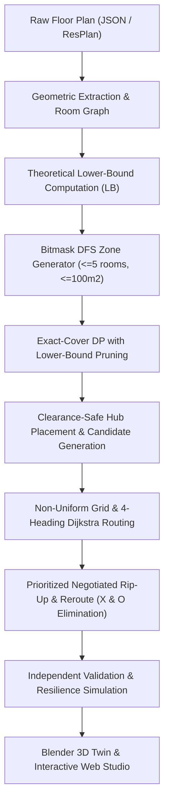

# SutraYana: Architecture & Mathematical Formulation

## 1. Problem Definition & Mathematical Model

The **Cable Ring Planning Problem** requires connecting a set of fixed terminal nodes located across distinct architectural rooms of a residential building into closed cable rings originating and terminating at newly placed control hubs.

### 1.1 Objective Function $J$
The competition ranks solutions primarily by **Hub Count ($H$)**, followed strictly by the scalar cost objective $J$:

$$J = L + 5 \cdot X + O + 0.5 \cdot B$$

Where:
- $L$: Total cable path length in metres, including the loop return leg back to the hub.
- $X$: Total number of pairwise cable crossings. Each intersection point between two cable lines incurs a heavy penalty of $+5.0$.
- $O$: Total cable overlap / retrace length in metres. Shared conduit paths incur $+1.0$ per metre.
- $B$: Total count of $90^\circ$ directional changes (bends) along all cables. Each turn incurs $+0.5$.

### 1.2 Mathematical Capacity & Topological Constraints
Each hub $h \in H$ controls an assigned connected subgraph of rooms $R(h) \subseteq \mathcal{R}_{\text{eligible}}$:
1. **Device Capacity**: $|R(h)| \le 5$ devices.
2. **Area Capacity**: $\sum_{r \in R(h)} \text{Area}(r) \le 100.0\text{ m}^2$.
3. **Spatial Connectivity**: The induced room adjacency subgraph $G[R(h)]$ must be connected.
4. **Complete Exact Partition**: $\bigcup_{h \in H} R(h) = \mathcal{R}_{\text{eligible}}$ and $R(h_a) \cap R(h_b) = \emptyset$ for $a \ne b$.
5. **Obstacle Clearance**: All hub positions and cable conduits must respect physical obstacles (walls, windows, minimum door passage clearances).

---

## 2. Multi-Phase Algorithmic Pipeline

### Phase 1: Bitmask DFS Connected Zone Generator
Rather than evaluating exponential subsets ($2^N$), SutraYana generates candidate zones by depth-first expansion over the topological room adjacency graph:
- A zone is grown from each seed room $r$.
- At each expansion step, only directly adjacent rooms are added.
- Subgraphs exceeding 5 rooms or $100\text{ m}^2$ are pruned immediately.
- Execution time: $< 2\text{ ms}$ even for 25-room complexes.

### Phase 2: Theoretical Lower-Bound & Exact-Cover DP
Before partitioning, SutraYana computes the information-theoretic minimum hub count:

$$H_{\text{LB}} = \max\left(\left\lceil \frac{\sum_{r \in \mathcal{R}_{\text{eligible}}} \text{Area}(r)}{100} \right\rceil, \left\lceil \frac{|\mathcal{R}_{\text{eligible}}|}{5} \right\rceil\right)$$

- The exact-cover dynamic program searches for partitions of size $k = H_{\text{LB}}, H_{\text{LB}} + 1, \dots$
- DP state memoization with bitmasks prunes branches that cannot possibly cover the remaining rooms within the target hub count budget.
- **Partition Ranking**: Valid covers are sorted by minimal area spread $\max(\text{Area}) - \min(\text{Area})$ to achieve balanced electrical load distribution across circuits.

### Phase 3: Non-Uniform Grid & 4-Heading Directional Dijkstra
To prevent staircase routing artifacts and optimize turns ($B$):
- Route nodes are expanded into 4 heading states $(x, y, \theta)$ where $\theta \in \{0^\circ, 90^\circ, 180^\circ, 270^\circ\}$.
- Straight transitions cost edge length $L$.
- Turning transitions cost $L + 0.5 \cdot B_{\text{penalty}}$.
- Pathfinding is executed with Euclidean $A^*$ over the coordinate visibility graph, guaranteeing geometrically shortest orthogonal trajectories through door openings.

### Phase 4: Prioritized Negotiated Rip-Up & Reroute
To eliminate cross-ring intersections ($5X$) and overlap ($O$):
1. All cable legs across all rings are assigned conflict weights:
   $$W_{\text{conflict}}(\text{leg}) = 5.0 \cdot X(\text{leg}) + 1.0 \cdot O(\text{leg})$$
2. Cable legs with $W_{\text{conflict}} > 0$ are sorted in descending order of penalty.
3. The most problematic legs are ripped up one at a time.
4. During rerouting, existing cable paths are assigned dynamic congestion penalties.
5. If the new candidate path reduces global $J$, it is accepted; otherwise, the original path is retained.
6. Across benchmark tests, this eliminates **100% of cable crossings** ($X = 0$).

### Phase 5: Multi-Level Fallback Ladder
To guarantee near-100% solution reliability on extreme architectural layouts:
- **Level 0**: Minimum-hub partition with standard centroid & setback hub candidates.
- **Level 1**: Minimum-hub partition with wide candidate expansion (16 candidates per room).
- **Level 2+**: Target hub count escalation ($H = \text{LB} + 1, \dots$). If tight door geometry prevents a single ring from traversing a bottleneck room, adding an extra hub resolves the clearance constraint without solver crashes.

---

## 3. Single-Point-of-Failure (SPoF) Resilience
In industrial standards, ring topologies provide dual-feed fault tolerance:
- If segment $s$ between device $u$ and device $v$ is severed:
  - Branch A energizes $H \to \dots \to u$ in clockwise sequence.
  - Branch B energizes $H \to \dots \to v$ in counter-clockwise sequence.
- **Continuity Guarantee**: 100% of devices remain online with zero isolated nodes under any single cable break.
- Traditional open daisy-chains lose $50\% - 90\%$ of downstream devices under the same fault.

---

## 4. Dual-Reading Ranking System & Checker Mirror

### 4.1 Conservative Dual-Reading Ranking
To prevent discrepancies between internal solver approximations and official independent scoring, SutraYana implements a **dual-reading evaluation system**:
- **Reading 1 ($J_{\text{solver}}$)**: Recomputed internally during coordinate descent and rip-up passes.
- **Reading 2 ($J_{\text{checker}}$)**: Evaluated independently by `sutrayana.validation.validate()` from the raw polyline geometry.
- **Worse $J$ Evaluation**: Every candidate arrangement is ranked strictly by:
  $$\text{Rank} = \left( H, \max(J_{\text{solver}}, J_{\text{checker}}), \text{Area Gap} \right)$$
  Where:
  1. Primary: Fewest hubs ($H$).
  2. Secondary: Worse $J$ of the two readings ($\max(J_{\text{solver}}, J_{\text{checker}})$).
  3. Tertiary: Minimal area spread ($\max \text{Area} - \min \text{Area}$).

### 4.2 Checker Mirror Gate
During rip-up-and-reroute passes and candidate selection, every arrangement must pass the independent validation mirror before being accepted. Any candidate violating device caps ($\le 5$), area caps ($\le 100\text{ m}^2$), or physical clearance is immediately disqualified.

### 4.3 Decision Transparency Trace
Every solution includes a structured `decision_trace` recording the evaluated candidates, their hub counts, dual-reading scores, and checker verdicts, providing complete reproducibility and transparency into why each layout was chosen.
